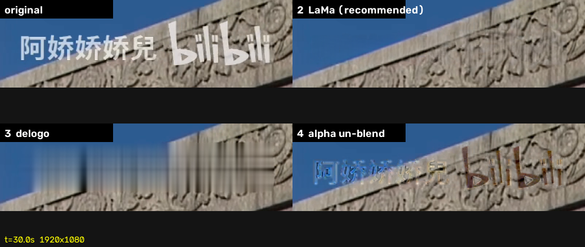

**简体中文** | [English](README.md)

# bilibili-watermark-remover

一个用来去掉视频里**哔哩哔哩（B站）水印**的 agent skill —— 就是 UP 主昵称 + 台标那个叠加层，
B站 每次转码上传都会烙上去。

它只做这一件事，也拒绝做别的：先检测、先验证，确认是 B站 的水印才动手。
理由是 B站 的水印只有一套画法，所以一套算法能覆盖它产出的所有视频。

三种去除方式随仓库一起提供，而且 skill 一定会先把对比图摆出来再开渲染：

| # | 方式 | 效果 | 速度（1080p/30fps，GPU） |
|---|---|---|---|
| 2 | **LaMa** 生成式修复 | 看不见痕迹；修补处略软 | 0.06–0.25 s/帧 |
| 3 | delogo 插值 | 背景有细节时会拖出糊条 | 大致实时 |
| 4 | alpha 反解 | 亮背景下留字迹轮廓 | 极快 |

推荐 2，因为在三者里只有它是**重建**被盖住的画面，其余都是拿周围的像素去糊。

*同一帧、同一处裁切。LaMa 把石雕浮雕重建了出来；delogo 留下竖向糊条；
alpha 反解保住了字形轮廓。这就是推荐 2 的理由。*

## 为什么需要它

去水印不是"拿模糊盖一下"。B站 的叠加层是一个**半透明白色合成**
（obs = alpha*255 + (1-alpha)*bg，alpha ≈ 0.70），而且整条片子位置固定。
正是这两点让"干净地去掉"在物理上成立 —— 但前提是先测出精确的字形掩膜，
并且只改这些像素。所有捷径（矩形模糊、拉伸裁切、delogo 跑两遍）都会留下
肉眼可见的破绽，这个仓库的存在就是为了不在每条片子上重新踩一遍。

## 安装

**作为 DSH / Claude 风格的 skill** —— 把目录拷进 skills 文件夹：

    cp -r bilibili-watermark-remover ~/.agents/skills/

之后你只要说"帮我去掉这个 B站 视频的水印"，agent 就会自动加载它。

**纯命令行** —— 脚本也能单独跑：

    # 需要先装 ffmpeg，各平台命令见 references/SETUP.md
    pip install -r requirements.txt

    python3 scripts/detect_watermark.py input.mp4 -o wm_work
    python3 scripts/make_preview.py     input.mp4 --work wm_work -o preview.png
    python3 scripts/remove_lama.py      input.mp4 out.mp4 --work wm_work
    python3 scripts/verify_result.py    out.mp4 --src input.mp4 --work wm_work

LaMa 权重（约 205 MB）首次运行时自动下载，带 sha256 校验；
下载不通时的镜像地址写在 references/SETUP.md 里。

## 直接给链接

所有脚本都接受 B站 链接，放链接和放本地文件一样，它自己会先下载：

    python3 scripts/detect_watermark.py \
      'https://www.bilibili.com/video/BV1p5sm6vEJe' -o wm_work

下载走 [yt-dlp](https://github.com/yt-dlp/yt-dlp)，落在
`~/.cache/bilibili-wm-remover/media/<hash>/`（键 = 链接 + 清晰度），重跑直接复用，
所以检测、预览、渲染三步只下一次片子。换缓存位置用 `BILI_WM_MEDIA_DIR`。

cookie 依次取 `--cookies` → `$DSH_VIDEO_COOKIES` → `~/.dsh/video.json` 的
`cookies` 字段 —— 和 DSH 视频插件是同一套来源，装过 DSH 且登录过 B站 的机器
不用再配。没有 cookie 也能跑，只是上限 720p；1080p 及以上要登录态。

只想先单独把片子下下来（大文件适合挂后台）：

    python3 scripts/fetch_source.py '<链接>' --height 1080 -o wm_work

## 每个脚本干什么

| 脚本 | 需要 torch | 作用 |
|---|---|---|
| fetch_source.py | 否 | 链接 → 本地文件（yt-dlp），打印落在哪 |
| detect_watermark.py | 否 | 找到并验证水印，输出掩膜/alpha/报告 |
| make_preview.py | 可选 | 生成四宫格对比图（没有 torch 就跳过 LaMa 那一格） |
| remove_lama.py | **是** | 生成式修复，推荐方式 |
| remove_delogo.py | 否 | 高速 ffmpeg 滤镜，画面太细时主动警告 |
| remove_alpha.py | 否 | 反解 alpha 混合 |
| verify_result.py | 否 | 输出残留量与 SSIM，不达标直接返回非零 |

没有 torch 也能用 3、4 两种方式加检测 —— 在决定投入 40 分钟跑 LaMa 之前，
先快速看一眼效果，这正是它们存在的意义。

## 硬件

设备自动选择：MPS（Apple Silicon）→ CUDA → XPU（Intel）→
DirectML（Windows，任意 DX12 显卡）→ CPU。

| 设备 | 每帧 | 5 分钟片子 |
|---|---|---|
| Apple M5（MPS） | 0.23 s | 约 35 分钟 |
| RTX 3060（CUDA） | 约 0.07 s | 约 10 分钟 |
| Intel Iris Xe（DirectML） | 约 0.5 s | 约 70 分钟 |
| 纯 CPU | 约 4 s | 数小时 |

只有 512×512 的那一小块进模型，峰值内存不到 2 GB —— 8 GB 的笔记本就够。

## 检测是怎么做的（不用样板图）

1. **静止性。** 把高通能量在采样帧上取中位数：会动的画面细节被抹掉，
   固定不动的叠加层留了下来。
2. **细亮笔画。** 用 gray - medianBlur(gray) 把字形抠出来，顺带去掉平滑背景。
3. **形态闸。** 看长宽比、占画面比例，以及右半边是否有密集的台标团块
   （B站 是先画昵称再画台标）—— 这一条负责把别家水印和各种静态图形挡掉。
4. **解 alpha。** 在背景有差异的帧对之间算 1-alpha = d(obs)/d(bg)。

检测与分辨率、位置都无关，所以 1080p、4K、竖屏、水印不在左上角都能用。

闸没过就停下来并说清楚，而不是硬渲一版废片。要强行处理可以用
`--bbox x,y,w,h` 手工指定位置。

## 用数字验收，不靠肉眼

verify_result.py 给的是两个数，不是一句"看着还行"：

- **残留量** —— 掩膜区域相对外圈的亮度差，跟原片对比
  （用当前的外圈定义，原片约 +114；好的结果在 +6 以下）；
- **SSIM** —— 重编码没有伤到画面其余部分。

参考片上的结果：残留 +114.7 → +1.0（去除率 99.1%），SSIM 0.988，
帧数与原片一致（8593），音轨逐位拷贝。验收按每 N 帧抽样（默认 30），
所以只要十几秒，不用整片解码。

## 目录结构

    SKILL.md                  给 agent 看的流程与硬性规则
    scripts/                  流水线（见上面的表格）
    references/
      SETUP.md                各平台安装、GPU 后端、报错对照
      PITFALLS.md             这条流水线踩过的每个坑，按代价排序
      MEASUREMENTS.md         水印实测参数与性能基准
    requirements.txt

## 适用范围与立场

这个工具是给**你自己的投稿**用的 —— 把自己做的片子恢复成干净母版，
或者处理那些只剩 B站 转码版的素材。它不是用来抹掉别人作品署名的工具；
水印的意义本来就在于指回作者。片子不是你的，就去找创作者要原文件。

## 许可证

本仓库采用 MIT 许可证 —— 见 [LICENSE](LICENSE)。

**第三方：** LaMa 的模型权重（`big-lama.pt`）不在本仓库内，是运行时下载的，
由原作者按 Apache-2.0 分发（[advimman/lama](https://github.com/advimman/lama)）。
ffmpeg、PyTorch、OpenCV 各自保留自己的许可证。
