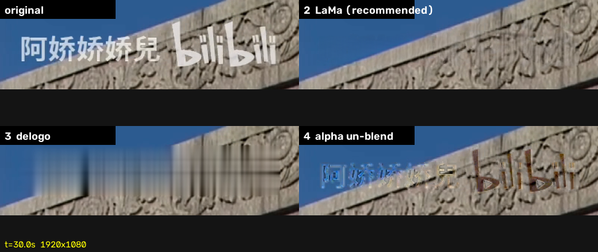

# bilibili-watermark-remover

An agent skill that removes the **Bilibili (哔哩哔哩) watermark** from a video — the
uploader-name + logo overlay that B站 burns into every re-encoded upload.

It refuses to work on anything else: the mark is detected and validated first, and
the whole point is that B站 uses one drawing style, so one algorithm covers every
video it produces.

Three removal methods ship with it, and the skill always shows you the comparison
before it renders anything:

| # | Method | Looks like | Speed (1080p/30fps, GPU) |
|---|---|---|---|
| 2 | **LaMa** generative inpainting | invisible; slightly softer inside the patch | 0.06-0.25 s/frame |
| 3 | delogo interpolation | smears on detailed backgrounds | roughly real time |
| 4 | alpha un-blend | ghost outlines on bright backgrounds | very fast |

Method 2 is what gets recommended, because it is the only one that rebuilds the
hidden picture instead of smearing the neighbours over it.

*Same frame, same crop. LaMa reconstructs the stone relief; delogo leaves vertical
smear; alpha un-blend keeps the glyph outlines. That is why the skill recommends 2.*

## Why this exists

Removing a watermark is not "cover it with a blur". The Bilibili overlay is a
semi-transparent white composite (obs = alpha*255 + (1-alpha)*bg, alpha ~ 0.70)
that is static for the whole clip. Those two properties make a *clean* removal
possible - but only if you detect the exact glyph mask first and only touch those
pixels. Every shortcut (a rectangle blur, a stretched crop, a repeated delogo)
fails in a visible way, and this skill exists to avoid re-learning that on every
video.

## Install

**As a DSH / Claude-style skill** - copy this directory into your skills folder:

    cp -r bilibili-watermark-remover ~/.agents/skills/

The agent then picks it up when you ask to remove a B站 watermark.

**Standalone CLI** - the scripts work on their own:

    # ffmpeg is required; see references/SETUP.md for per-platform installs
    pip install -r requirements.txt

    python3 scripts/detect_watermark.py input.mp4 -o wm_work
    python3 scripts/make_preview.py     input.mp4 --work wm_work -o preview.png
    python3 scripts/remove_lama.py      input.mp4 out.mp4 --work wm_work
    python3 scripts/verify_result.py    out.mp4 --src input.mp4 --work wm_work

The LaMa weights (~205 MB) download automatically on first use, with a sha256
check. Mirrors are listed in references/SETUP.md.

## What runs where

| Script | Needs torch | What it does |
|---|---|---|
| detect_watermark.py | no | finds + validates the mark, writes mask/alpha/report |
| make_preview.py | optional | 4-up comparison still (skips LaMa panel without torch) |
| remove_lama.py | **yes** | generative repair, the recommended method |
| remove_delogo.py | no | fast ffmpeg filter, warns when the footage is too detailed |
| remove_alpha.py | no | inverts the alpha blend |
| verify_result.py | no | residual + SSIM, exits non-zero when it fails |

Without torch you still get methods 3 and 4 plus detection - useful for a quick
look before committing to a 40-minute LaMa render.

## Hardware

Device selection is automatic: MPS (Apple Silicon) then CUDA then XPU (Intel)
then DirectML (Windows, any DX12 GPU) then CPU.

| Device | per frame | 5-minute clip |
|---|---|---|
| Apple M5 (MPS) | 0.23 s | ~35 min |
| RTX 3060 (CUDA) | ~0.07 s | ~10 min |
| Intel Iris Xe (DirectML) | ~0.5 s | ~70 min |
| CPU only | ~4 s | several hours |

Only the 512x512 patch goes through the model, so peak memory stays under 2 GB -
an 8 GB laptop is enough.

## How detection works (no logo template)

1. **Static-ness.** High-pass energy is medianed over sampled frames; moving
   scene detail cancels, the fixed overlay survives.
2. **Thin bright strokes.** gray - medianBlur(gray) isolates the glyphs and
   removes the smooth background.
3. **Shape gate.** Aspect ratio, on-screen share, and a dense logo cluster on the
   right half (B站 draws text then logo) - this is what rejects every other
   watermark and every static graphic.
4. **Alpha solve.** 1-alpha = d(obs)/d(bg) between frame pairs whose background
   differs.

Detection is resolution- and position-independent, so it works for 1080p, 4K,
vertical uploads and marks in a corner other than the top-left.

If the gate fails, the skill stops and says so rather than rendering garbage.
--bbox x,y,w,h lets a human override it.

## Verify, don't eyeball

verify_result.py reports two numbers instead of an opinion:

- **residual** - mean brightness of the mask area relative to the ring around it,
  compared against the source (B站 mark ~ +46; a good result is under +6);
- **SSIM** - the re-encode did not damage the rest of the picture.

On the reference clip: residual +114.7 to +1.0 (99.1% removed), SSIM 0.988,
frame count identical (8593), audio copied bit-for-bit. Verification samples every
Nth frame (default 30) so it costs ~18 s instead of a full decode.

## Layout

    SKILL.md                  the agent-facing workflow and hard rules
    scripts/                  the pipeline (see table above)
    references/
      SETUP.md                per-platform installs, GPU backends, error table
      PITFALLS.md             every trap this pipeline hit, in order of cost
      MEASUREMENTS.md         measured watermark parameters and benchmarks
    requirements.txt

## Scope and intent

This is for **your own uploads** - recovering a clean master of a video you made,
or re-editing footage that only survives as a B站 re-encode. It is not a tool for
stripping attribution from other people's work; the watermark exists to point back
at its author. If the clip is not yours, get the file from the creator instead.

## License

This repository is MIT licensed - see [LICENSE](LICENSE).

**Third-party:** the LaMa model weights (`big-lama.pt`) are not part of this
repository. They are downloaded at runtime and are distributed under Apache-2.0
by their original authors ([advimman/lama](https://github.com/advimman/lama)).
ffmpeg, PyTorch and OpenCV keep their own licenses.
